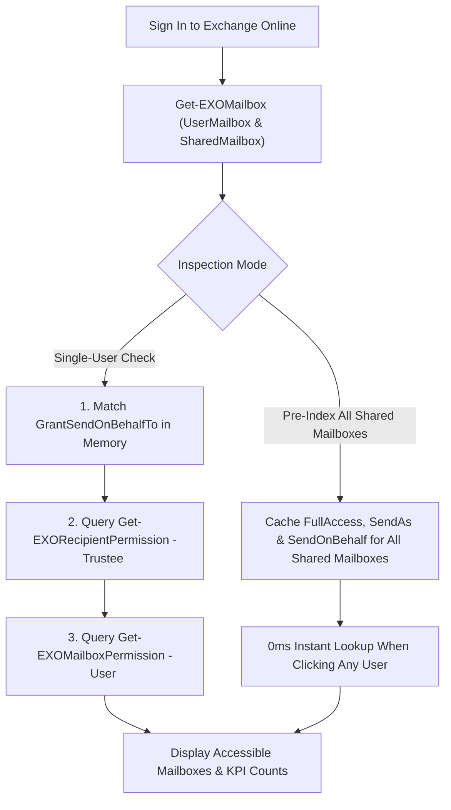

# Microsoft 365 Shared Mailbox Access Viewer Guide

## Overview

The **Microsoft 365 Shared Mailbox Access Viewer** is a desktop WPF GUI auditing tool for IT administrators and Managed Service Providers (MSPs). It solves the operational challenge of quickly determining which Shared Mailboxes (and optionally delegated User Mailboxes) a specific user has access to across an Exchange Online tenant without manually running slow per-mailbox PowerShell loops.

Because Microsoft Graph API does not expose Exchange Online mailbox delegation permissions (`FullAccess`, `SendAs`, and `SendOnBehalf`), this utility connects directly to **Exchange Online PowerShell (`Connect-ExchangeOnline`)** with a single interactive sign-in, loads the directory of users and shared mailboxes, and inspects all three permission types in one unified split-pane view.

---

### Key Features

*   **Single Interactive Sign-In (`Connect-ExchangeOnline`):** Uses the native Windows interactive sign-in popup window (WAM / embedded modal dialog) without opening external web browser tabs, plus one-click **Reconnect / Switch** support for multi-tenant MSP workflows.
*   **Complete Permission Coverage:** Checks all three Exchange Online delegation types:
    *   **Full Access** (`Get-EXOMailboxPermission`)
    *   **Send As** (`Get-EXORecipientPermission`)
    *   **Send on Behalf** (`GrantSendOnBehalfTo`)
*   **Dual Inspection Modes:**
    *   **On-Demand Single-User Check:** Select any user from the searchable left-hand directory and click **Check Selected User's Access** (or double-click the user) to inspect their permissions.
    *   **Instant Tenant Index (`0ms` User Switching):** Click **Pre-Index All Shared Mailboxes** once to index delegations across all Shared Mailboxes in memory. Once indexed, clicking any user in the directory displays their accessible mailboxes instantaneously.
*   **Optional Delegated User Mailbox Auditing:** Toggle **Include Delegated User Mailboxes** to also check whether the selected user has been granted delegated access to other regular user mailboxes.
*   **Real-Time Search & Permission Filtering:** Filter the user list by name, email/UPN, or alias, and filter results by `Full Access Only`, `Send As Only`, or `Send On Behalf Only`.
*   **CSV Reporting:** Export a per-user Shared Mailbox access report or a complete tenant-wide delegation matrix to CSV.

---

## Prerequisites

*   **Operating System:** Windows 10 (Build 1909+) or Windows 11 / Windows Server 2019+
*   **PowerShell Runtime:** Windows PowerShell 5.1 (`powershell.exe`) or PowerShell 7+ (`pwsh.exe`)
*   **Permissions:** Exchange Administrator, Global Reader, or Global Administrator role in the target Microsoft 365 tenant.
*   **Dependencies:**
    *   `ExchangeOnlineManagement` PowerShell module (v3.0.0+):
        ```powershell
        Install-Module ExchangeOnlineManagement -Scope CurrentUser
        ```

---

## Walkthrough & Usage Guide

### 1. Step-by-Step Instructions

1.  **Launch the Application:**
    *   Double-click `Start-Gui.bat` in the tool folder, or run `SharedMailboxAccessViewer.ps1` from PowerShell.
2.  **Sign In to Exchange Online:**
    *   Click **Sign In to Exchange Online** in the top-right header.
    *   Complete authentication in the native Microsoft interactive sign-in popup window.
    *   Once signed in, the application automatically retrieves all User Mailboxes and Shared Mailboxes and populates the left-hand **1. Select User** list.
3.  **Check a User's Shared Mailbox Access:**
    *   Use the **Search** box in the left pane to filter by Display Name, Email/UPN, or Alias.
    *   Select a user and click **Check Selected User's Access** (or double-click the user row).
    *   *(Optional)* If you plan to check several users in the same session, click **Pre-Index All Shared Mailboxes** in the top bar once; after indexing finishes, clicking any user on the left updates the right pane immediately (`0ms`).
4.  **Review & Export Results:**
    *   Review the KPI summary cards (**Mailboxes**, **Full Access**, **Send As**, **Send On Behalf**) and the detailed results grid showing each mailbox's Display Name, Email, Type, Permissions Summary, and GAL Visibility (`Visible` / `Hidden`).
    *   Click **Export User CSV** to save the selected user's report, or **Export All Users CSV** to export the full tenant delegation report to the `Reports/` folder.

---

### Logging & Diagnostics

All operational events, connection steps, and permission queries are logged both in the bottom in-app console drawer and to disk:

| Location | Description |
| :--- | :--- |
| `C:\Logs\SharedMailboxAccessViewer\SharedMailboxAccessViewer_dd-MM-yy.log` | UK-timestamped (`dd/MM/yy HH:mm:ss`) diagnostic log of Exchange Online connections, mailbox queries, and CSV exports (falls back to `%LOCALAPPDATA%\Logs\SharedMailboxAccessViewer\` if `C:\Logs` is restricted). |
| `.\Reports\` | Default output directory for exported single-user and full-tenant CSV reports. |

---

### How Detection & Inspection Work



---

## Fast Execute

> [!TIP]
> **Full Transparent GitHub Command:**
> ```powershell
> iex (irm "https://raw.githubusercontent.com/jamesapf-hub/PowerShell/main/Scripts/Microsoft%20365/SharedMailboxAccessViewer/SharedMailboxAccessViewer.ps1")
> ```
>
> **Run locally:**
> Double-click `Start-Gui.bat` or run:
> ```powershell
> powershell.exe -STA -ExecutionPolicy Bypass -File .\SharedMailboxAccessViewer.ps1
> ```
